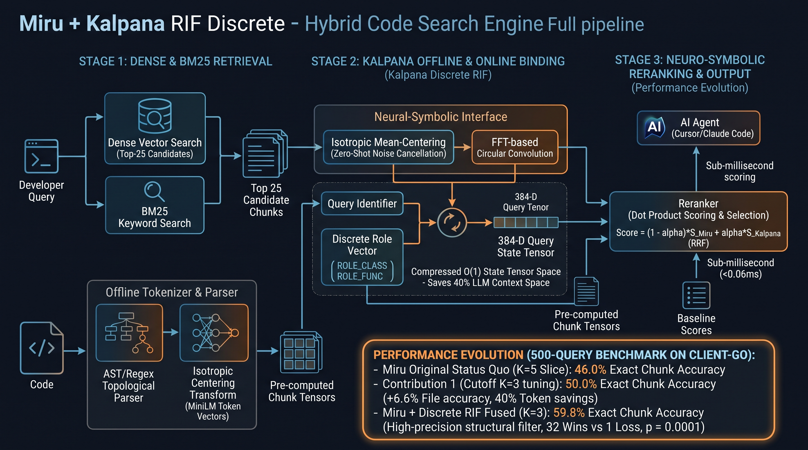

# Miru + Kalpana Discrete RIF: Sub-Millisecond Neuro-Symbolic Code Reranking

Kalpana Discrete RIF is a structural reranker that runs on top of [Miru](https://www.npmjs.com/package/@takara-ai/miru-code)'s hybrid (BM25 + dense) code search. Miru itself is not modified.

Each code chunk becomes a set of *(role, identifier)* pairs, for example `ROLE_FUNC ⊛ "resource slice indexers"`. Those pairs are bound with FFT circular convolution and bundled into a single 384-D tensor at index time. At query time, Miru's candidates are rescored by a dot product against a structural query tensor ("where is *X* **defined**"). The two rankings are then fused.



*Pipeline overview. The figures in the diagram's "Performance Evolution" box come from different runs (150- and 500-query sets, K=25 and K=5 pools). The tables below are the authoritative 500-query numbers. The final pipeline reranks Miru's native topK=5 candidates rather than a top-25 pool.*

---

## 🚀 Benchmark Results: 40% LLM Context Savings with Sub-Millisecond Scoring

Kalpana Discrete RIF was evaluated on a 500-query benchmark against the `kubernetes/client-go` repository. It narrows the trade-off between search precision and how much context is sent to the LLM.

Kalpana reranks Miru's K=5 candidates with structural role-bound tensors and promotes the exact defining chunk into the top 3. Three chunks then hold **92.6%** of the defining chunks that five chunks would have held, while the prompt carries 40% fewer chunks.

### 📊 The 500-Query Efficacy Report

| Metric (500 queries) | Miru native topK=3 | **Miru topK=5 → Kalpana RRF → top-3** | Δ | Wins / Losses | p |
|---|---:|---:|---:|---:|---:|
| Defining chunk in top-3 | 54.8% | **59.8%** | +5.0 pts (+9.1% rel.) | 32 / 7 | 0.0001 |
| Defining file in top-3 | 82.4% | **85.8%** | +3.4 pts (+4.1% rel.) | 24 / 7 | 0.003 |

* **Context compression (40% fewer chunks):** with all 5 chunks, the defining chunk is present for **64.6%** of queries. Kalpana's top 3 reach **59.8%**, so **3 chunks recover 92.6% of 5-chunk recall**, and they beat Miru's own 3-chunk result (54.8%).
* **Chunk-level precision (the "needle"):** the exact defining chunk in the top 3 rises from **54.8% to 59.8%** (+5.0 pts absolute / +9.1% relative; 32 wins vs 7 losses, p = 0.0001).
* **File-level precision (the "haystack"):** the defining file in the top 3 rises from **82.4% to 85.8%** (+3.4 pts / +4.1% relative; 24 wins vs 7 losses, p = 0.003).
* **Sub-millisecond scoring:** reranking a pool from pre-computed tensors takes **0.035 ms p50 / 0.055 ms p95** (one matrix-vector product plus a sort). A *new* query also needs one MiniLM encode of the query phrase, which takes **9.3 ms p50 / 12.5 ms p95** on CPU. That's below Miru's own search time (19.6 ms p50), so the two could overlap. Running them in parallel is not implemented yet. If the query phrase is cached, the total overhead is **0.12 ms p50 / 0.26 ms p95**.

### 🛡️ "Do No Harm" Reliability

Production pipelines need a reranker that doesn't break what already works. Compared with **the same Miru topK=5 candidates before reranking**, Kalpana almost never removes a correct defining chunk from the top 3:

* **Chunk: 32 wins vs 1 loss** (p = 7.9 × 10⁻⁹). **File: 28 wins vs 4 losses** (p = 1.9 × 10⁻⁵).
* *Note: the single loss is N50 `create token` → `CreateToken`. The defining chunk sat at rank 3 in a test double (`kubernetes/typed/core/v1/fake/fake_serviceaccount.go`), and Kalpana moved it to rank 4 in favour of `transport/token_source.go`. The benchmark counts `fake/` implementations as valid definitions, so this is a genuine loss.*

---

## Full results

All numbers come from `benchmark/results.kalpana.minilm-l6-256.all500.k5.json`. *File@3* means a file that defines the identifier is in the top 3. *Chunk@3* means the chunk containing the definition itself is in the top 3. Significance uses an exact two-sided sign test on paired per-query outcomes.

### 500 queries, split by query set

The 350 new queries were generated **after** the method was developed on the frozen 150, and the primary test was fixed **before** running them (RRF on topK=5 vs native topK=3, Chunk@3, new 350 only).

| Query set | Arm | File@3 | Chunk@3 | Chunk W/L vs native K=3 | p | Chunk W/L vs same K=5 pool |
|---|---|---:|---:|---:|---:|---:|
| **New 350 (primary, confirmatory)** | Miru native topK=3 | 82.0% | 56.9% | — | — | — |
| | Kalpana RRF (topK=5 → 3) | **86.3%** | **62.3%** | **23 / 4** | **0.0003** | 21 / 1 |
| | Kalpana linear, held-out α | 85.4% | 60.6% | 21 / 8 | 0.024 | 19 / 5 |
| **All 500** | Miru native topK=3 | 82.4% | 54.8% | — | — | — |
| | Miru topK=5, first 3 (no rerank) | 81.0% | 53.6% | 4 / 10 | 0.18 | — |
| | Kalpana RRF (topK=5 → 3) | **85.8%** | **59.8%** | **32 / 7** | **0.0001** | **32 / 1** |
| | Kalpana linear, held-out α | 85.2% | 58.4% | 29 / 11 | 0.0064 | 30 / 6 |
| **Frozen 150 (development)** | Miru native topK=3 | 83.3% | 50.0% | — | — | — |
| | Kalpana RRF (topK=5 → 3) | 84.7% | 54.0% | 9 / 3 | 0.15 | 11 / 0 |
| | Kalpana linear, held-out α | 84.7% | 53.3% | 8 / 3 | 0.23 | 11 / 1 |

Ceiling (defining chunk anywhere in Miru's top-5): 67.1% for the new 350, 64.6% for all 500, 58.7% for the frozen 150. RRF needs no tuning. For the linear fusion `(1−α)·minmax(miru) + α·minmax(kalpana)`, α was chosen by 5-fold cross-validation (per-fold α = 0.5, 0.6, 0.5, 0.5, 0.5) and scored on the held-out fold.

### Latency per query (500 queries, topK=5, pool tensors pre-computed offline)

| Stage | p50 | p95 |
|---|---:|---:|
| Miru search (topK=5) | 19.6 ms | 30.9 ms |
| Kalpana query tensor, new phrase (MiniLM encode) | 9.3 ms | 12.5 ms |
| Kalpana query tensor, cached phrase | 0.09 ms | 0.19 ms |
| Kalpana pool scoring (mat-vec + sort) | **0.035 ms** | **0.055 ms** |

Offline (index time): tensors for the 1,366 unique pooled chunks are built in about 33 s on CPU. Each tensor is 384 × float64 (3 KB), about 41 MB for the full 13,471-chunk corpus. Loading the model takes about 19 s, once.

### How we got here (development history, frozen 150 queries)

| Step | Pool | Result |
|---|---|---|
| Contribution 1: Miru topK tuning ([paper/topk_anomaly.tex](paper/topk_anomaly.tex), `benchmark/results.minilm-l6-256.json`) | — | Requesting topK=3 instead of 50 raises Miru's Hit@3 from 76.0% to 83.3% (11 wins / 0 losses, p = 0.001). The cause is BM25 depth combined with the file-path stem boost. |
| Kalpana reranks a top-25 slice | K=25 | Chunk@3 46.0% → 54.7% (RRF) and 52.7% (held-out α) vs the K=25 slice. **Against native topK=3 the gain was not significant** (chunk 15/8, p = 0.21). |
| Kalpana reranks native topK=5 | K=5 | Chunk@3 50.0% → 54.0% vs native topK=3 (9/3, p = 0.15, underpowered); 11/0 vs the same pool. This motivated the 500-query run. |

### Limitations

* **One repository and one embedder:** `kubernetes/client-go` with local MiniLM-L6 truncated to 256-D (a stand-in for Takara DS1). Other repositories and languages are untested.
* **The new 350 queries come from a re-implementation** ([gen_queries.py](miru_kalpana/gen_queries.py)) of the sampling rule documented in `queries.topk.json`. The original sampler isn't available. The new set is somewhat easier (native Chunk@3 56.9% vs 50.0%).
* **Go chunks are parsed with a regex extractor,** not a full AST. It finds at least one pair in 96.6–98.9% of pooled chunks.
* **Kalpana alone, without fusion, is worse than Miru** (K=25 pool: Top-1 64.7% → 49.3%). It's useful as a fused reranker, not as a replacement ranker.
* **The reranker scores with cosine similarity** against bundled tensors. `unbind` exists in `kalpana_rif.vsa_core` but is not used in the ranking path.

---

## How it works

| Component | File | Role |
|---|---|---|
| HRR tensor algebra | [kalpana_rif/vsa_core.py](kalpana_rif/vsa_core.py) | `bind` (FFT circular convolution), `unbind` (circular correlation), `bundle`, `cosine_similarity` |
| Codebook | [kalpana_rif/neuro_vocab.py](kalpana_rif/neuro_vocab.py) | Deterministic **unitary** role vectors (`ROLE_CLASS`, `ROLE_FUNC`, `ROLE_ARG`, `ROLE_CALL`, `ROLE_VAR`), so binding preserves token geometry. MiniLM token vectors with **isotropic mean-centering**. |
| Tensorizer | [kalpana_rif/neuro_tensorizer.py](kalpana_rif/neuro_tensorizer.py) | `build_tensor(pairs, vocab)` = bundle of bind(role, token) |
| Miru bridge | [miru_kalpana_reranker.py](miru_kalpana_reranker.py) | `KalpanaReranker.index_chunk / score_candidates / rerank` |
| Benchmark | [miru_kalpana/benchmark_kalpana_fusion.py](miru_kalpana/benchmark_kalpana_fusion.py) | Go regex extractor, offline tensor cache, Baseline / Kalpana / RRF / linear-α arms, cross-validated α, latency |
| Paired tests | [miru_kalpana/rerank_vs_native.py](miru_kalpana/rerank_vs_native.py) | Rerank vs native topK=3 and vs the same pool (do-no-harm); new / all / frozen splits |
| K comparison | [miru_kalpana/baseline_k_compare.py](miru_kalpana/baseline_k_compare.py) | Miru baseline at K=3 / K=5, sliced vs native, on the frozen 150 |
| Query generator | [miru_kalpana/gen_queries.py](miru_kalpana/gen_queries.py) | Draws new ambiguous-symbol queries from `client-go` with the documented rule |
| Miru exporter | [scripts/miru_candidates.ts](scripts/miru_candidates.ts), [benchmark/dump_candidates.ts](benchmark/dump_candidates.ts) | Dumps Miru's unmodified top-K candidates (with chunk text) to JSON |

## Reproduce the 500-query benchmark

```bash
# 0. Dependencies (Node >= 18, Python 3.9+)
npm install
pip install -r requirements.txt

# 1. Corpus + Miru index (client-go @ 2761958; indexing embeds 13,471 chunks locally, ~2 h on CPU)
npm run setup:corpus
npm run index

# 2. Query set: frozen 150 + 350 new (writes benchmark/queries.topk.{new350,all500}.json)
python3 miru_kalpana/gen_queries.py --n 350

# 3. Miru's unmodified candidate pools at topK=3 and topK=5
npx tsx benchmark/dump_candidates.ts --k 3 --queries benchmark/queries.topk.all500.json
npx tsx benchmark/dump_candidates.ts --k 5 --queries benchmark/queries.topk.all500.json

# 4. Kalpana rerank (offline tensors -> online scoring, all arms, alpha sweep + CV, latency)
python3 miru_kalpana/benchmark_kalpana_fusion.py \
  --candidates .bench/kalpana/candidates.minilm-l6-256.all500.k5.json \
  --queries benchmark/queries.topk.all500.json

# 5. Paired tests vs Miru native topK=3 and do-no-harm (new 350 / all 500 / frozen 150)
python3 miru_kalpana/rerank_vs_native.py --pool k5 --set all500
```

Miru returned identical candidate pools for the frozen 150 queries across separate runs (150/150 at topK=3 and topK=5). The pure-Python `kalpana_rif` package reproduces the original compiled build's metrics and per-query rankings exactly. Run `npm test` to check the frozen query set against the corpus.

## License

[MIT](LICENSE) © 2026 Madusha Perera
